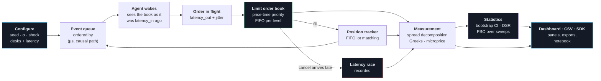

<div align="center">
  
  
</div>

<p align="center">
  <a href="https://github.com/IshaanS0112/TradeArenaX/actions/workflows/ci.yml"></a>
  
  
  
  
  
</p>

<p align="center">
  <b>A market simulator that measures its own results instead of asserting them.</b><br>
  Run competing trading desks against a real limit order book, then read back
  <i>why</i> each one made or lost money, and whether the answer is statistically meaningful.
</p>

<div align="center">
  
  <sub><i>1,000 steps · 5 desks · per-agent latency · a −8% shock at step 500. The tear through the middle of the heatmap is the shock.</i></sub>
</div>

---

## What it measures

Rows 1–3 come from one command, so you can regenerate them rather than take them on trust:

```bash
cd backend && python scripts/benchmark.py --markdown
```

| Question | Answer, seed 42 | Pinned by |
|---|---|---|
| How much of the spread did the maker **keep**? | `17.63 bps` quoted → `27.08 bps` kept, `−9.45 bps` impact | [`test_microstructure.py`](backend/tests/test_microstructure.py) |
| What did **being slow** cost? | `154` fills where the maker's cancel was still on the wire; worst `1.8 ms` late | [`test_event_engine.py`](backend/tests/test_event_engine.py) |
| Did any money appear from nowhere? | `Σ PnL + fees = 1.9e-10` across all 5 desks | [`test_simulation_engine.py`](backend/tests/test_simulation_engine.py) |
| Is the **microprice** a better fair value than the mid? | **No.** RMSE `0.173` for the microprice against `0.163` for the mid, one step ahead | [`test_microprice.py`](backend/tests/test_microprice.py) |
| Is a good backtest result **real or luck**? | Deflated Sharpe and Probability of Backtest Overfitting over the parameter grid | [`test_statistics.py`](backend/tests/test_statistics.py) |
| Does adding latency change the physics? | At zero latency the event engine reproduces the step loop **exactly**, shock included | [`test_event_engine.py`](backend/tests/test_event_engine.py) |

Two are worth reading twice. **Impact is negative** in this draw: the price moved *towards* the maker after its fills, so it kept more than it quoted. That is the opposite of adverse selection, and the sign is measured rather than assumed. The microprice row is a **no**. A tool that only confirms what it was built to confirm is not measuring anything.

## Install

```bash
pip install -e backend               # the simulator: numpy + pydantic, nothing else
pip install -e "backend[server]"     # + the HTTP API (FastAPI, SQLAlchemy)
pip install -e "backend[frames]"     # + pandas output
```

The simulator has no database dependency. A test asserts that importing it loads no ORM and no database driver.

## Use it from a notebook

```python
from app.sdk import Desk, Shock, simulate

run = simulate(
    steps=1000,
    seed=42,
    shocks=[Shock(step=500, pct=-8.0)],
    agents=[
        Desk("mm", "MARKET_MAKER", latency_out_us=1200, latency_jitter_us=300),
        Desk("flow", "NOISE_TRADER", activity=0.5, latency_out_us=400),
    ],
)

run.summary["total_trades"]   # trades executed
run.conservation              # Σ PnL + fees, zero to float noise
run.spread()                  # effective = realised + impact, per desk
run.races()                   # fills that beat their own maker's cancel
run.frame("agents")           # pandas DataFrame, with the frames extra
```

The notebook and the API call the same functions, so they cannot disagree about one run.

## Quick start

```bash
docker compose up --build
```

| | |
|---|---|
| Dashboard | <http://localhost:5173> |
| API docs | <http://localhost:8000/docs> |
| Every formula in force | <http://localhost:8000/meta/engine-config> |

<details>
<summary>Without Docker (Python 3.12, Node 20)</summary>

```bash
# Backend. Migrations run on startup, so a fresh database needs no extra step.
cd backend
python3.12 -m venv .venv && source .venv/bin/activate
pip install -r requirements-test.txt
DATABASE_URL="sqlite:///./tradearenax.db" uvicorn app.main:app --reload

# Frontend, second shell
cd frontend && npm install && npm run dev
```

Run the engine alone, with no database and no HTTP layer:

```bash
cd backend && python scripts/demo_run.py --steps 1000 --shock-step 500 --shock-pct -8
```

</details>

## How a run flows



The loop from the position tracker back to the queue is what makes this a simulation rather than a replay: a fill changes an agent's inventory, which changes the quotes it sends next.

## Four views of the same run

The dashboard is a module registry. Each panel declares the data it needs, the shell does the fetching, and a new visualisation is one entry in [`registry.ts`](frontend/src/modules/registry.ts). Every panel with a table behind it has a CSV button, and the layout lives in the URL so a view can be shared.

<table>
<tr>
<td width="50%"><br/><b>Performance.</b> PnL per desk with the shock marked, the reference path against the book's own mid, and a metric matrix that prints a dash wherever the data cannot support a number.</td>
<td width="50%"><br/><b>Risk.</b> The spread split into what the maker kept and what informed flow took back, one contested fill on a microsecond timeline, and signed inventory per desk.</td>
</tr>
<tr>
<td width="50%"><br/><b>Derivatives.</b> Gamma, theta and hedging slippage on a delta-hedged options book, next to whether the microprice forecasts anything.</td>
<td width="50%"><br/><b>Microstructure.</b> Resting liquidity as terrain over price and time, the book ladder at any step, and depth as a heatmap with the shock as a visible tear.</td>
</tr>
</table>

## What's modelled

| Layer | What it does |
|---|---|
| **Order book** | Price-time priority. Integer tick grid, per-level FIFO queues, partial fills, lazy cancels, three self-trade policies. Fills at the *resting* price. |
| **Event clock** | Priority queue over `(timestamp_µs, causal path)`. Per-desk feed delay, order flight time and jitter, so a cancel can genuinely lose a race. |
| **Five desks** | Inventory-skewing market maker · momentum · mean reversion · uninformed noise flow · options maker that hedges its delta into the same book. |
| **Accounting** | FIFO lot matching through position flips. Sharpe on an equity curve, not on raw PnL. Drawdown that stays non-negative when PnL does not. |
| **Derivatives** | Black-Scholes with analytic Greeks, implied vol by bracketed Brent, SVI surface fits with butterfly and calendar arbitrage checks. |
| **Statistics** | Stationary bootstrap, Lo (2002) standard errors, Deflated Sharpe Ratio, PBO via CSCV, purged k-fold with embargo. No SciPy. |

The price path is **synthetic**: geometric Brownian motion with configurable jumps. That buys exact reproducibility (same seed, same result, across processes) and lets you schedule a −15% gap at step 400, which no live feed will do on request.

## Correctness

Every trade moves value between two participants, so:

```
Σ(all desks' PnL) + fees collected == 0
```

This runs on every simulation, including every path of every ensemble. Almost any error in fill application, lot matching or mark-to-market breaks it.

Three bugs this project found the hard way, each now a regression test:

- **Float dust at the bottom of a price level.** Ten shares taken in nine slices leaves `1.78e-15`. The level survived pruning, `best_bid` reported a price where nothing rested, and the run aborted as a crossed book.
- **`hash()` is not stable across processes.** Agents seeded from it were reproducible within a run and silently different in the next. Seeds now use `zlib.crc32`, tested across three `PYTHONHASHSEED` values.
- **Some option quotes identify no implied volatility.** Deep in the money, the price is bit-identical across a wide volatility range. The inversion returns `None` with the consistent interval instead of an artefact of float spacing.

## API

<details>
<summary>Full endpoint list</summary>

```
POST   /simulations                                        Create (price process + shocks)
GET    /simulations                                        List
GET    /simulations/{id}                                   Detail, with agents
DELETE /simulations/{id}                                   Delete (cascades)
POST   /simulations/{id}/agents                            Add a desk (type, config, latency)
GET    /simulations/{id}/agents                            List desks
POST   /simulations/{id}/run                               Run N steps
GET    /simulations/{id}/agents/{agent_id}/performance     Per-step PnL and inventory
GET    /simulations/{id}/comparison                        Metrics + conservation check
GET    /simulations/{id}/order-book/snapshot?step=         Book, replayed at any step
GET    /simulations/{id}/liquidity-surface                 Depth over (time × price)
GET    /simulations/{id}/microstructure                    Effective / realised / impact
GET    /simulations/{id}/latency-races                     Fills that beat their own cancel
GET    /simulations/{id}/microprice                        Microprice vs mid, forecast RMSE
GET    /simulations/{id}/greeks/attribution                Gamma / theta / vega / slippage

POST   /ensembles                                          N seeded paths (202, background)
GET    /ensembles, /ensembles/{id}                         List, status and aggregates
GET    /ensembles/{id}/distribution                        Histograms and bootstrap CIs
GET    /ensembles/{id}/paths                               Per-path results
DELETE /ensembles/{id}

POST   /sweeps                                             Parameter grid (202, background)
GET    /sweeps, /sweeps/{id}                               List, cells, PBO, robust centroid
GET    /sweeps/{id}/surface                                2-parameter slice
DELETE /sweeps/{id}

GET    /meta/agent-defaults                                Every tunable, with its default
GET    /meta/engine-config                                 Every formula and constant
```

A misspelled config key returns 422 rather than silently defaulting. The resolved config is stored with every run, because a Sharpe ratio cannot be verified without `capital_base` and `steps_per_year`.

</details>

## Where to read next

| | |
|---|---|
| [`docs/product-and-technical-spec.md`](docs/product-and-technical-spec.md) | PRD and TRD: what it does and why, user flows, the full schema, every endpoint with its error states, security posture, deployment |
| [`docs/architecture.md`](docs/architecture.md) | Step ordering that prevents look-ahead bias, schema reasoning, the full test strategy, lessons learned |
| [`backend/app/sdk.py`](backend/app/sdk.py) | The notebook front door. Start here to use the simulator without the server |
| [`backend/scripts/benchmark.py`](backend/scripts/benchmark.py) | Regenerates the figures in *What it measures* |
| [`backend/app/services/`](backend/app/services/) | `order_book.py` → `event_engine.py` → `microstructure.py` → `statistics.py` |
| [`frontend/src/modules/`](frontend/src/modules/) | One file per panel. `registry.ts` is the index |

## Limitations

Single instrument, and no agent learning. The maker observes true fair value, while the directional agents provably do not ([`test_no_lookahead.py`](backend/tests/test_no_lookahead.py) perturbs the field by 50% and asserts their decisions are unchanged). Order arrivals are agent-driven, not Hawkes or queue-reactive. The exchange itself is instantaneous. Ensembles run as background tasks, not on a job queue. The dashboard polls rather than streaming.

## Licence

MIT, see [LICENSE](LICENSE).

**Not investment advice.** A research and education tool on synthetic data, with no connection to any market data feed, exchange or broker. See [DISCLAIMER.md](DISCLAIMER.md).
