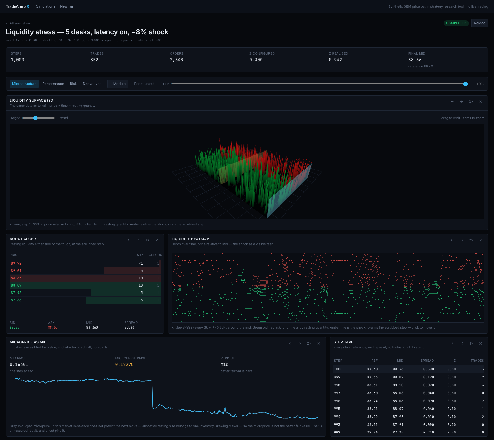
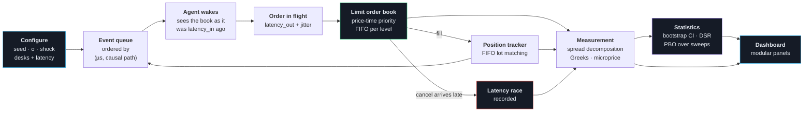
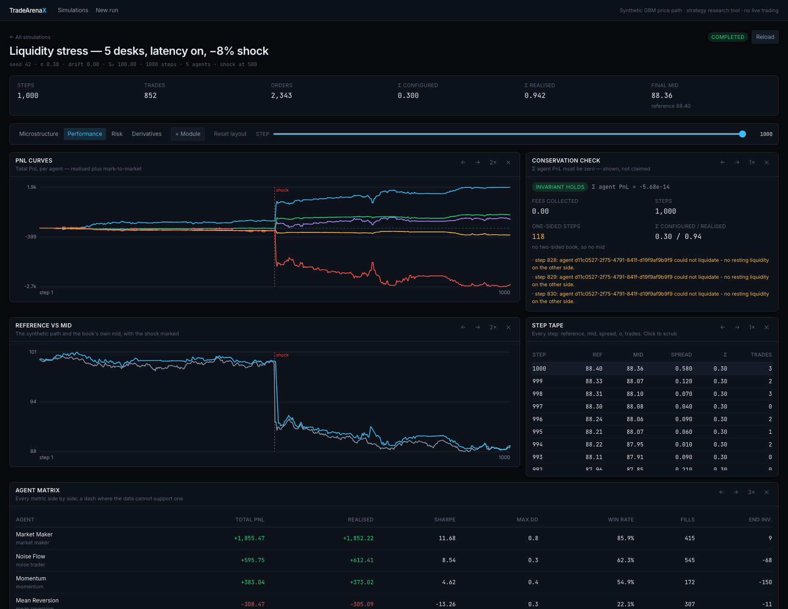
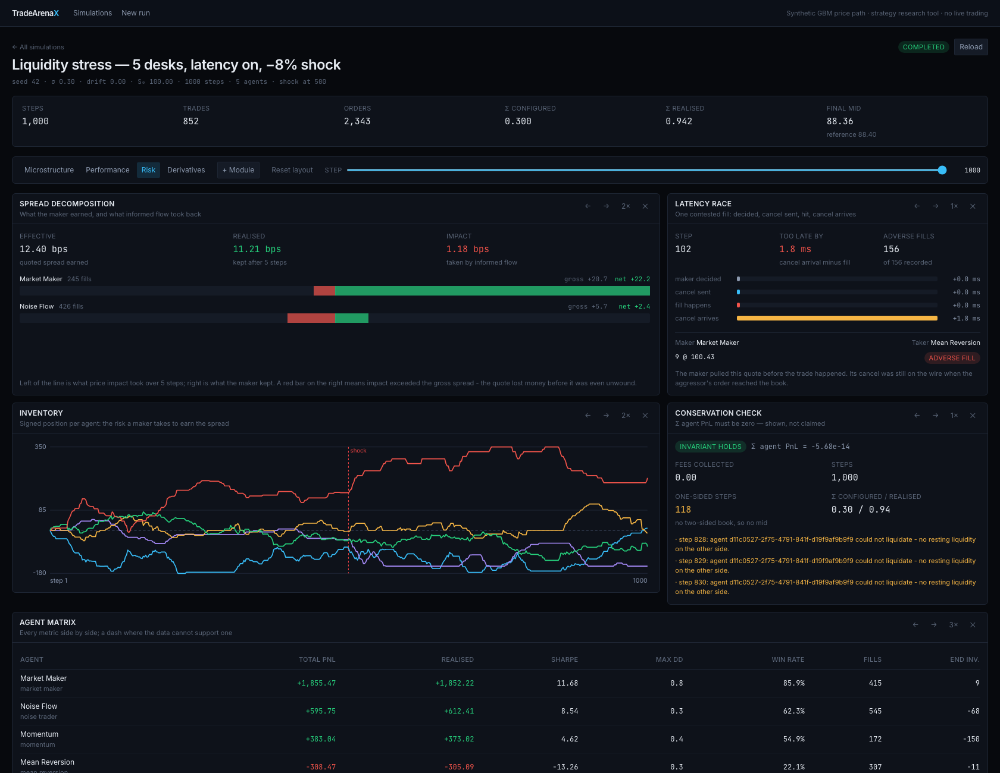
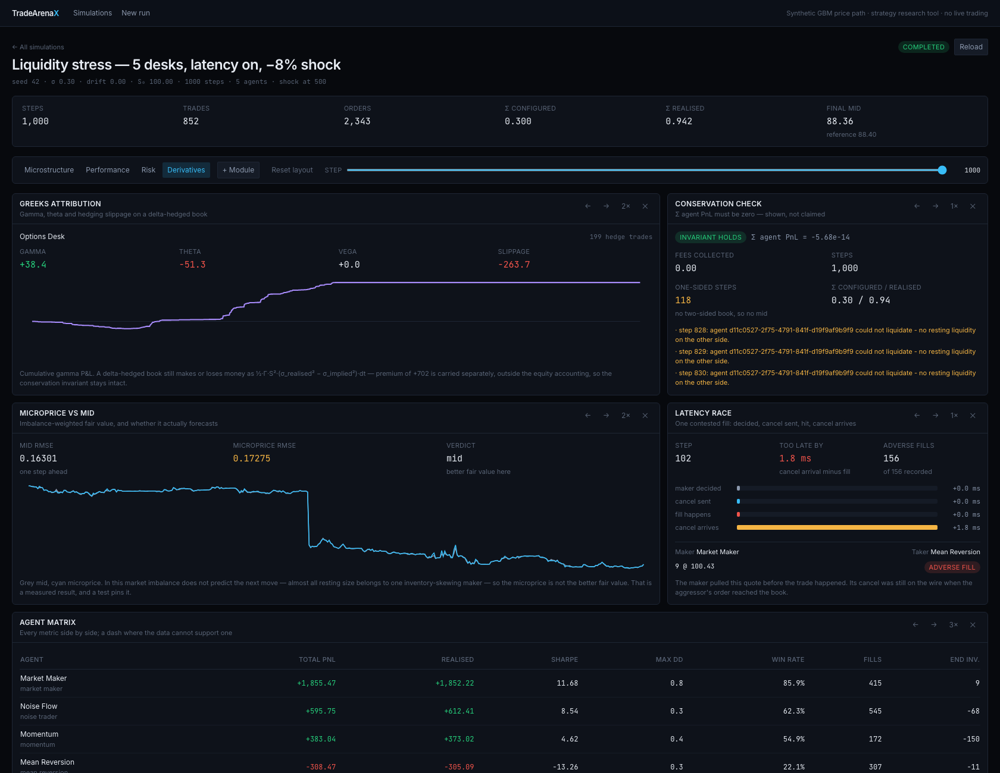

<div align="center">
  
  
</div>

<p align="center">
  <a href="https://github.com/IshaanS0112/TradeArenaX/actions/workflows/ci.yml"></a>
  
  
  
  
  
</p>

<p align="center">
  <b>A market simulator that measures its own results instead of asserting them.</b><br>
  Run competing trading desks against a real limit order book, then read back
  <i>why</i> each one made or lost money — with the statistics to say whether the answer means anything.
</p>

<div align="center">
  
  <sub><i>1,000 steps · 5 desks · per-agent latency · a −8% shock at step 500. The tear through the middle of the heatmap is the shock.</i></sub>
</div>

---

## What it measures

Every number in the first three rows comes from one command, so you can check them rather than take them:

```bash
cd backend && python scripts/benchmark.py
```

| Question | Answer, seed 42 | Pinned by |
|---|---|---|
| How much of the spread did the maker **keep**? | `17.63 bps` quoted → `27.08 bps` kept, `−9.45 bps` impact | [`test_microstructure.py`](backend/tests/test_microstructure.py) |
| What did **being slow** cost? | `154` fills where the maker's cancel was still on the wire; worst was `1.8 ms` late | [`test_event_engine.py`](backend/tests/test_event_engine.py) |
| Did any money appear from nowhere? | `Σ PnL + fees = 1.9e-10` across all 5 desks | [`test_simulation_engine.py`](backend/tests/test_simulation_engine.py) |
| Is the **microprice** a better fair value than the mid? | **No** — RMSE `0.173` vs `0.163` for the pictured run. The mid wins here, and the project says so | [`test_microprice.py`](backend/tests/test_microprice.py) |
| Is a good backtest result **real or luck**? | Deflated Sharpe + Probability of Backtest Overfitting over the parameter grid | [`test_statistics.py`](backend/tests/test_statistics.py) |
| Does adding latency change the physics? | At zero latency the event engine reproduces the step loop **exactly**, 300 steps, shock included | [`test_event_engine.py`](backend/tests/test_event_engine.py) |

Two of those are worth reading twice. **Impact is negative** in this draw — the price moved *towards* the maker after its fills, so it kept more than it quoted. That is the opposite of adverse selection and it is what the decomposition is for: the sign is measured, not assumed. And the microprice row is a **no**. A tool that only confirms what it was built to confirm is not measuring anything.

## Use it from a notebook

The engine has no database dependency, so the simulator installs without the web stack:

```bash
pip install -e backend          # numpy + pydantic, no FastAPI, no Postgres
```

```python
from app.sdk import Desk, Shock, simulate

run = simulate(
    steps=1000,
    seed=42,
    shocks=[Shock(step=500, pct=-8.0)],
    agents=[
        Desk("mm", "MARKET_MAKER", latency_out_us=1200, latency_jitter_us=300),
        Desk("flow", "NOISE_TRADER", activity=0.5, latency_out_us=400),
    ],
)

run.summary["total_trades"]   # 896
run.conservation              # 1.9e-10 — the invariant, on every run
run.spread()                  # effective = realised + impact, per desk
run.races()                   # fills that beat their own maker's cancel
run.frame("agents")           # pandas, with the frames extra
```

Every number there comes from the same functions the HTTP layer calls, so a notebook and the API cannot disagree about the same run. A test asserts importing the SDK pulls in no ORM, no SQLAlchemy and no database driver.

## Quick start

```bash
docker compose up --build
```

| | |
|---|---|
| Dashboard | <http://localhost:5173> |
| API docs | <http://localhost:8000/docs> |
| Every formula in force | <http://localhost:8000/meta/engine-config> |

<details>
<summary>Without Docker (Python 3.12 + Node 20)</summary>

```bash
# Backend — migrations run on startup, so a fresh database needs no extra step
cd backend
python3.12 -m venv .venv && source .venv/bin/activate
pip install -r requirements-test.txt
DATABASE_URL="sqlite:///./tradearenax.db" uvicorn app.main:app --reload

# Frontend, second shell
cd frontend && npm install && npm run dev
```

No database, no HTTP layer — just the economics:

```bash
cd backend && python scripts/demo_run.py --steps 1000 --shock-step 500 --shock-pct -8
```

</details>

## How a run flows



The loop back from the position tracker to the queue is what makes this a simulation rather than a replay: a fill changes an agent's inventory, which changes the quotes it sends next.

## Four views of the same run

The dashboard is a **module registry** — each panel declares the data it needs and the shell does the fetching, so a new visualisation is one entry in [`registry.ts`](frontend/src/modules/registry.ts). Layouts are shareable: the preset lives in the URL.

<table>
<tr>
<td width="50%"><br/><b>Performance</b> — PnL per desk with the shock marked, the reference path against the book's own mid, and a metric matrix that prints a dash wherever the data cannot support a number.</td>
<td width="50%"><br/><b>Risk</b> — the spread split into what the maker kept and what informed flow took back, one contested fill drawn on a microsecond timeline, and signed inventory per desk.</td>
</tr>
<tr>
<td width="50%"><br/><b>Derivatives</b> — gamma, theta and hedging slippage on a delta-hedged options book, next to whether the microprice actually forecasts anything.</td>
<td width="50%"><br/><b>Microstructure</b> — resting liquidity as terrain over price × time, the book ladder at any step, and depth as a heatmap with the shock as a visible tear.</td>
</tr>
</table>

## What's actually modelled

| Layer | What it does |
|---|---|
| **Order book** | Price-time priority. Integer tick grid, per-level FIFO queues, partial fills, lazy cancels, three self-trade policies. Fills at the *resting* price. |
| **Event clock** | Priority queue over `(timestamp_µs, causal path)`. Per-agent feed delay, order flight time and jitter — so a cancel can genuinely lose a race. |
| **Five desks** | Inventory-skewing market maker · momentum · mean reversion · uninformed noise flow · an options maker that hedges its delta into the same book. |
| **Accounting** | FIFO lot matching through position flips. Sharpe on an equity curve, not on raw PnL. Drawdown that stays non-negative when PnL is. |
| **Derivatives** | Black-Scholes with analytic Greeks, implied vol by bracketed Brent, SVI surface fits with butterfly and calendar arbitrage checks. |
| **Statistics** | Stationary bootstrap, Lo (2002) standard errors, Deflated Sharpe Ratio, PBO via CSCV, purged k-fold with embargo. No SciPy. |

The price path is **synthetic** — geometric Brownian motion with configurable jumps. That is deliberate: it buys exact reproducibility (same seed, same result, across processes) and lets you schedule a −15% gap at step 400, which no live feed will do on request.

## Correctness

Every trade moves value between two participants, so:

```
Σ(all desks' PnL) + fees collected == 0
```

This runs on **every simulation**, not just in tests — including every path of every ensemble. The residual is returned by the API and shown on the dashboard. Almost any error in fill application, lot matching or mark-to-market breaks it.

Three bugs this project found the hard way, each now a regression test:

- **Float dust at the bottom of a price level.** Ten shares taken in nine slices leaves `1.78e-15`, the level survived pruning, and `best_bid` reported a price where nothing rested — surfacing much later as a crossed book.
- **`hash()` is not stable across processes.** Agents seeded from it were reproducible within a run and silently different in the next one, voiding the project's central promise. Now `zlib.crc32`, tested across three `PYTHONHASHSEED` values.
- **Some option quotes identify no implied volatility.** Deep ITM, the price is bit-identical across a wide vol range. The inversion returns `None` with the consistent interval rather than an artefact of float spacing.

## API

<details>
<summary>Full endpoint list</summary>

```
POST   /simulations                                     Create (price process + shocks)
GET    /simulations/{id}/comparison                     Metrics + conservation check
GET    /simulations/{id}/order-book/snapshot?step=      Book, replayed at any step
GET    /simulations/{id}/liquidity-surface              Depth over (time × price)
GET    /simulations/{id}/microstructure                 Effective / realised / impact
GET    /simulations/{id}/latency-races                  Fills that beat their own cancel
GET    /simulations/{id}/microprice                     Microprice vs mid, forecast RMSE
GET    /simulations/{id}/greeks/attribution             Gamma / theta / vega / slippage
POST   /ensembles                                       N paths, distributions + CIs
POST   /sweeps                                          Parameter grid, PBO + robust centroid
GET    /meta/engine-config                              Every formula and constant
```

A misspelled config key returns 422 rather than silently defaulting, and the resolved config is persisted with every run — a stored Sharpe cannot be verified without knowing `capital_base` and `steps_per_year`.

</details>

## Where to read next

| | |
|---|---|
| [`docs/product-and-technical-spec.md`](docs/product-and-technical-spec.md) | PRD + TRD: what it does and why, user flows, the full schema, every endpoint with its error states, security posture, deployment |
| [`docs/architecture.md`](docs/architecture.md) | Step ordering that prevents look-ahead bias, schema reasoning, the full test strategy, lessons learned |
| [`backend/app/services/`](backend/app/services/) | `order_book.py` → `event_engine.py` → `microstructure.py` → `statistics.py` |
| [`frontend/src/modules/`](frontend/src/modules/) | One file per panel; `registry.ts` is the index |

## Limitations

Single instrument, no agent learning. The maker observes true fair value (the directional agents provably do not — [`test_no_lookahead.py`](backend/tests/test_no_lookahead.py) perturbs it 50% and asserts their decisions are unchanged). Order arrivals are agent-driven rather than Hawkes or queue-reactive. The exchange itself is instantaneous. Ensembles run on background tasks, not a real job queue. The dashboard polls rather than streaming.

## Licence

MIT — see [LICENSE](LICENSE).

**Not investment advice.** A research and education tool on synthetic data, with no connection to any market data feed, exchange or broker. See [DISCLAIMER.md](DISCLAIMER.md).
